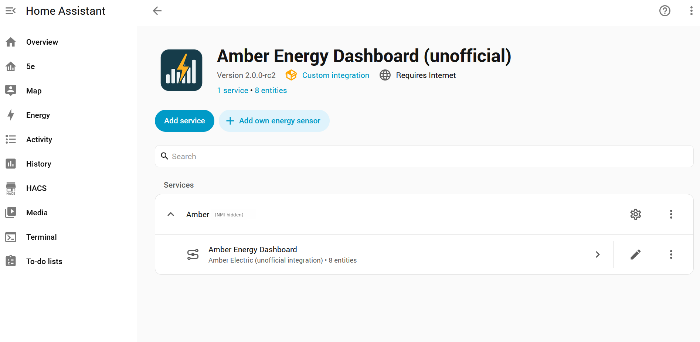

# Installation guide: Amber Energy Dashboard (unofficial)

This guide walks through installing and setting up the integration. If you used the
earlier YAML kit, see the separate [migration guide](MIGRATION.md) once the integration is
set up. For a short overview, see the [README](../README.md).

**Contents**
1. [Before you start](#1-before-you-start)
2. [Install through HACS](#2-install-through-hacs)
3. [Add the integration](#3-add-the-integration)
4. [After setup](#4-after-setup)
5. [Settings](#5-settings)
6. [Add it to the Energy dashboard](#6-add-it-to-the-energy-dashboard)
7. [Migrating from the YAML kit](#7-migrating-from-the-yaml-kit) (separate guide)
8. [Troubleshooting and FAQ](#8-troubleshooting-and-faq)

---

## 1. Before you start

You need:

- **Home Assistant 2026.9 or later.**
- **[HACS](https://hacs.xyz/)** installed.
- **An Amber Electric API key** (see below).

### Creating an Amber API key

1. Sign in to Amber's website and open **For Developers** (https://app.amber.com.au/developers).
   Turn on **Developer mode** if it's off.
2. Click **Generate a new Token**, give it a recognisable name (for example
   "HomeAssistantAmberEnergyDash"), and click **Generate**.

   

3. **Copy the token straight away** and store it in your password manager. Amber only shows
   it once; it disappears when you refresh the page. It starts with `psk_`.

   

   *(The token in this screenshot was deleted straight after it was taken. Never share a
   working token.)*

The integration works alongside Home Assistant's built-in **Amber Electric** integration,
which provides live prices. You can keep both.

## 2. Install through HACS

1. In HACS, open the **three-dot menu** (top right) and choose **Custom repositories**.

   

2. Enter `https://github.com/r5e/ha-amber-energy-dashboard`, choose the type
   **Integration**, and click **Add**. Then close the dialog.

   

3. Search HACS for **amber**, and open **Amber Energy Dashboard (unofficial)**. (Other
   Amber-related entries in the list are separate projects.)

   

4. Click **Download** (bottom right).

   

5. Click **Download**, then **restart Home Assistant** when prompted.

   HACS offers the latest release.¹

¹ *Pre-releases (release candidates) are not offered by default. To try one, open **Need a
different version?** in the download dialog and pick it from the list.*

## 3. Add the integration

1. Go to **Settings > Devices & services > Add integration**, and search for **Amber**.
   Choose **Amber Energy Dashboard (unofficial)**, not the built-in Amber Electric
   integration.

   

2. **Connect to Amber:** paste your API key and click **Submit**.

   

3. **Choose a site:** if your Amber account has more than one site, pick the first one to
   set up. The entry is your Amber account; you add its other sites afterwards with
   **Add site** (see "More than one site" in section 4). Each site is shown with the last
   four digits of its NMI and its network.

   

4. **Name the site:** the integration shows the site's details (its network, the last
   four digits of its NMI, and the date it became active with Amber) and asks for a
   friendly name, for example **Home** or **Beach house**. The name becomes the site
   device's name; entity IDs don't depend on it. If you also use Amber Express, giving
   the site the same name there makes the two sets of devices easy to match. To rename
   the site later, see "Renaming the site" in section 4.

   <!-- TODO(screenshot): the "Name this site" step. The maintainer to supply as
        images/site-name-step.png. -->
   *(Screenshot to follow.)*

5. **Confirm channels:** the integration lists the metering channels it found, for
   example a general (import) channel and a feed-in (export) channel, each with its
   tariff code. Usage, cost and feed-in compensation are imported for each one.

   

6. **Import schedule:** keep **Automatic** unless you have a reason not to. It picks a
   stable time for your installation each morning (between 06:30 and 08:30), with retries
   3 and 6 hours later. Once the day is imported, the retries are skipped without any API
   calls. **Fixed times** lets you choose up to 6 times yourself.

   If the Energy dashboard has no grid connection yet, this step also offers **Add to the
   Energy dashboard** (on by default). It adds a grid connection with this site's
   consumption and cost and, with feed-in, its return to grid and compensation (a
   controlled load gets a second grid connection), so you can skip section 6. An existing
   grid connection is never changed, and the option isn't shown then.

   

7. **Name and assign:** optionally rename the device or assign it to an area, then click
   **Finish**.

   

The integration then imports your available history straight away (Amber keeps about 90
days). That takes a minute or two and about 15 API calls.

## 4. After setup

Open the site's device (named after your site, for example **Home**) to see its status.
Its model line shows the network and the NMI's last four digits, for example
"Endeavour Energy · NMI …1234":

- **Import status** reads **Up to date** when everything is imported.
- **Last imported date** is normally yesterday, because Amber publishes each day's usage
  about a day later.
- **Days behind** is 0 when it's up to date.
- **Yesterday** sensors show the previous day's energy, cost and feed-in compensation per
  channel.
- **Next scheduled run** (under Diagnostic) shows when it will next check.
- **Run now** (under Controls) runs the import straight away, the same as a scheduled run.
  You rarely need it.
- **Re-check retention** (under Diagnostic) finds the oldest day Amber still holds again
  from scratch (at most 8 API calls). The daily check normally follows it by itself.
- With the **bill estimate** or the **export allowance** turned on (section 5), their
  sensors appear here too:

  
- **Download diagnostics** produces a file for bug reports. Your API key and NMI are
  redacted from it.

The integration's own page (Settings > Devices & services > Amber Energy Dashboard)
shows the entry for each site:

### How the integration page is laid out

The entry is your **Amber account** (its API key), titled **Amber Energy Dashboard**. If
you set up a second account (a second API key), each title gets its first site's name,
for example **Amber Energy Dashboard (Beach house)**. Rename an entry (its **⋮** menu) and
the integration leaves your name alone.

Under the entry, Home Assistant groups the sub-entries by kind:

- **Site:** each site, titled by its name (for example **Home**; a site set up before
  version 2.2 is titled **Site …1234** until you rename it). Its device holds the status
  sensors, the Yesterday sensors and the buttons described above. The site's device is
  named after the site; installs from before version 2.2 keep **Amber Energy Dashboard
  (site)** until you rename it.
- **Grid meter** and **Appliance:** each one you add (section 5), listed by its title, for
  example **Whole house meter · grid meter** or **Pool heat pump · appliance (general
  E1)**. Each has its own device, named as you named it, which holds its sensors and links
  back to its site's device.
- **Own energy sensor (2.1):** own energy sensors added before version 2.2, each with a
  device **<sensor name> (own sensor)**, until you convert them (section 5).

Every device belongs to one of these, so there is no longer a heading "Devices that don't
belong to a sub-entry".

<!-- TODO(screenshot): the integration page with a site, a grid meter and an appliance.
     The maintainer to supply as images/integration-layout.png. -->
*(Screenshot to follow.)*

### More than one site

If your Amber account has several sites (for example a home and a holiday house), click
**Add site** on the integration's page. It lists the sites your API key can see that aren't
set up yet; choose one, give it a name, and confirm its channels. Each site imports on its
own schedule, but the sites of one account take turns, so together they stay within
Amber's rate limit (which belongs to the account).

<!-- TODO(screenshot): the "Add a site" step. The maintainer to supply as
     images/add-site.png. -->
*(Screenshot to follow.)*

The site's entity IDs: the first site keeps `sensor.amber_energy_dashboard_…`; a further
site's follow its name, for example `sensor.beach_house_import_status`. Services and
actions take the site's device as **site** when there are several.

### Renaming the site, areas and labels

Use Home Assistant's own device page: open the site's device and click the **pencil**
icon. There you can rename it, and give it an area and labels. The integration treats
the name you set there as the site's name wherever it shows one (for example, with
several sites, in the entry's title, unless you have renamed the entry yourself). Entity
IDs never change with the name. Installs from before version 2.2 keep the name **Amber
Energy Dashboard (site)** until you rename the device this way.

## 5. Settings

A site's settings open from the **cog** next to the entry (with several sites, it asks
which one first) or from the **pencil** on the site's row. Both show the same menu:

**Import settings** contains:

- **Schedule:** Automatic or Fixed times, as during setup.
- **Usage mode:**
  - **Full** (default): imports usage and cost every day.
  - **Recovery-only:** imports nothing on a schedule. Use the `backfill` service to fill a
    date range on demand.
  - **Pricing-only:** writes no usage statistics, only prices and own-sensor cost.

  Switching mode never deletes statistics; ones no longer updated simply stop.
- **Price series:** optionally write an hourly price series per channel. Turning it on
  fetches the full retention window once (about 13 API calls).
- **Hourly fallback for own sensors:** for grid meters and appliances (below), Home
  Assistant keeps 5-minute data for only about 10 days. With this on (the default), older
  days are priced from hourly energy at the hour's average price and marked "lower
  precision"; with it off, they are skipped.
- **Patience days** and **Revision days:** how long to wait for missing days, and how long
  to re-check days Amber marked as estimated. The defaults suit almost everyone.

### Refresh channels

If Amber starts reporting a new metering channel for a site (for example a newly installed
controlled load), imports pause and a Repairs item says so. Open the site's settings and
choose **Refresh channels**: it shows what changed, and the new channel's statistics start
from the day imports paused.

### Bill estimate (optional)

Choose **Bill estimate** in the options menu:

Enter your **billing day**, the **daily supply charge**, the **Amber subscription** per
day, any **other daily charges** (all excluding GST), and the **GST rate** (10 %). See
[Finding these on your bill](#finding-these-on-your-bill) below. The device then shows
**Bill to date**, **Projected bill**, **Days into billing cycle** and **Average cost per
day** for the current cycle. The estimate runs a day behind, because only complete
imported days count, and it leaves out one-off charges such as card fees. Leave the
billing day empty to turn it off.

**Cost including fixed charges** (a checkbox in the same step) adds a statistic with your
import cost plus the fixed charges, for an Energy dashboard whose totals match the bill (see
section 6 for where to select it). It covers your whole history. If you change the charges
later, the new amounts apply from the day after the last imported day; earlier days keep
the old ones.

#### Finding these on your bill

- **Billing day:** the first day of your bill period. For "28 Aug – 27 Sep", enter
  **28**.
- **Daily supply charge** ($ per day, excluding GST): the **Network Daily Supply Charges**
  rate in your bill's **charges summary** (for example 1.0871). It **already includes
  metering**, so don't add the metering line separately (see the picture above).
- **Amber subscription** ($ per day, excluding GST): from your bill's **Amber Fees**
  section (for example 0.7471). **Enter 0 if your subscription is currently free** (for
  example a first-year offer), and update it when the offer ends (see the picture
  above).
- **Other daily charges** ($ per day, excluding GST): any other fixed daily charge on your
  bill. Optional; 0 by default.
- **GST:** 10 % by default. The bill adds GST to these charges; the integration does the
  same. Amber's usage figures already include GST, and export credits carry none.
- **Not included:** one-off charges, such as card payment fees.

### Export allowance (optional)

Some networks charge for exports in a midday window beyond a free allowance applied on the
bill (Endeavour Energy's N61: 8 kWh a day, over the billing period). Amber's usage data
charges every kWh in that window, so feed-in earnings look lower than on your bill. For N61
with a billing day set, the integration turns this on by itself; otherwise choose **Export
allowance** in the options menu and enter the allowance per day:

It adds the sensors **Export allowance used**, **Export allowance remaining** and **Export
charge after allowance**, uses the allowance in the bill estimate, and writes an
**adjusted compensation** statistic. To show the adjusted earnings in the Energy dashboard,
select it as the grid connection's compensation (section 6). Turning the allowance on (or
changing it) measures your imported days straight away, in the background, with a few API
calls; you don't need to press **Run now**.

### Adding a grid meter

A **grid meter** measures the energy flowing through your main supply, the same energy
Amber bills. Examples:

- a CT clamp or energy monitor on the mains feed;
- the grid meter of an inverter or battery system, for example a Sigenergy system's grid
  sensor or a Fronius smart meter.

On the integration's page, click **Add grid meter** and fill in the form below (if your
account has several sites, it first asks which site the meter belongs to):

- **Name:** for example **Whole house meter**. It names the meter's device and sensors.
- **Import energy sensor:** cumulative energy drawn from the grid (a kWh sensor that
  keeps rising, state class `total` or `total_increasing`).
- **Price import on:** shown only if your site has a controlled load: choose controlled
  load for a meter on that circuit. Otherwise the general channel is used.
- **Export energy sensor** (optional, shown when your site has a feed-in channel): the
  energy sent to the grid, priced at the feed-in rate.

<!-- TODO(screenshot): the "Add a grid meter" form. The maintainer to supply as
     images/add-grid-meter.png. -->
*(Screenshot to follow.)*

The integration then prices the meter's readings at Amber's billed rate for each 5-minute
interval, from the later of the sensor's history start and Amber's retention boundary:
`amber_energy_dashboard:<site>_own_<sensor>_cost` for the import and
`…_own_<sensor>_cost` (positive when earned) for the export.

The meter's device has:

- **Import reconciliation** and **Export reconciliation:** for the latest day both have,
  your meter's kWh minus Amber's billed kWh (the percentage and both totals are
  attributes). Because the meter measures the energy Amber bills, a difference shows
  calibration drift or readings that went missing.
- **Calibration offset** (with import and export): for each hour of the last 14 complete
  billed days, Amber's net energy (import minus export) minus the meter's, in watts; the
  sensor shows the median, with the hours used, the spread (interquartile range) and the
  date range as attributes. Hours where the meter's statistics have a gap are left out.
  A CT clamp typically shows a small, steady offset (tens of watts); an inverter's
  revenue-grade meter shows close to 0 W.

**Map the raw sensors.** Choose the sensors as the meter reports them, not ones you have
already corrected (for example with a template that adds the offset). The offset is
measured from the mapped sensors, so a corrected sensor would feed its own correction back
and the offset would drift towards zero.

### Adding your own appliances

An **appliance** is any single energy sensor. Examples:

- a smart plug;
- a CT clamp on one circuit;
- an appliance's own energy sensor, such as a heat pump or a hot water system;
- an EV charger.

Click **Add appliance** (with several sites, choose the site first) and fill in a **Name** (for example **Pool heat pump**), the
**Energy sensor**, and, if your site has a controlled load, the channel to price it on
(general by default; controlled load for, say, a hot water system on that circuit).

<!-- TODO(screenshot): the "Add an appliance" form. The maintainer to supply as
     images/add-appliance.png. -->
*(Screenshot to follow.)*

The appliance's cost is recorded as a statistic in the same way, and its device shows
**Yesterday energy** and **Yesterday cost**. An appliance is not compared with Amber's
billed totals: one circuit is only part of what the house draws, so the difference would
mean nothing.

A sensor can be priced by one grid meter or appliance only.

### Converting own energy sensors (from version 2.1)

Own energy sensors added before version 2.2 keep working unchanged: the same statistics,
entity IDs and reconciliation sensors. A Repairs item **"Convert own energy sensors to grid
meters and appliances"** offers to convert them:

- an import mapping (general or controlled load) and a feed-in mapping become one grid
  meter, named as you choose;
- every other mapping becomes an appliance, keeping its name.

The cost statistics and their history are kept, and the grid meter's reconciliation
sensors keep the old sensors' entity IDs. Appliances get Yesterday sensors in place of
reconciliation. You can also ignore the Repairs item and keep the old mappings.

## 6. Add it to the Energy dashboard

If you kept **Add to the Energy dashboard** on during setup (section 3), this is already
done. A day after the first import, if nothing in the Energy dashboard uses the
integration's statistics, a Repairs item **"The Energy dashboard isn't using Amber Energy
Dashboard"** appears. Its **Fix** adds them when there is no grid connection, points to
the [migration guide](MIGRATION.md) when the YAML kit is in use, or lets you dismiss it.

To set it up by hand, go to **Settings > Dashboards > Energy**, and in the **Electricity
grid** section, add or edit a grid connection. For cost and compensation, always choose
**Use an entity tracking the total costs** (or **the total received**), never "current
price". Choose the statistics like this (`<ch>` is the channel, for example `e1`):

| Field | Statistic | When |
|---|---|---|
| Grid consumption | general `…_<ch>_energy` | Always |
| Cost | general `…_<ch>_cost` | The default: your usage at Amber's billed prices |
| Cost | `…_<ch>_cost_incl_fixed` ("import cost including fixed charges") | If you turned it on under **Bill estimate** and want the dashboard's cost to match your bill. It already includes a controlled load's cost, so then leave the controlled-load connection's cost empty |
| Return to grid | feed-in `…_<ch>_energy` | Always, if you export |
| Compensation | feed-in `…_<ch>_compensation` | The default: your feed-in earnings as Amber's data pays them |
| Compensation | `…_<ch>_compensation_adjusted` ("compensation (export allowance applied)") | With the **Export allowance** on (two-way tariffs such as N61): matches the export credit on your bill |
| Controlled load | a second grid connection: controlled-load `…_<ch>_energy`, cost `…_<ch>_cost` | If you have a controlled load (leave its cost empty with the cost including fixed charges, as above) |

The optional statistics cover your whole history, so switching to them also changes how
past days are shown. "Add to the Energy dashboard" and the Repairs fix use the default
statistics; switch to the optional ones by hand. Give the connection a clear display name,
such as "Amber grid".

## 7. Migrating from the YAML kit

Only needed if you used the earlier YAML kit. See the separate
**[migration guide](MIGRATION.md)**: it carries your history across and fixes the kit's
feed-in sign, with a dry run and undo.

## 8. Troubleshooting and FAQ

**My feed-in earnings are lower than the export credit on my Amber bill.**
Amber's usage data applies your network's export charges to every interval. Some networks
offer a free export allowance (for example Endeavour Energy's two-way tariff N61, which has
8 kWh per day free before a midday export charge applies), and your bill applies that
allowance, but the usage data doesn't. So the dashboard can show lower feed-in earnings
than the bill. The **Export allowance** option (section 5) corrects for it. Import costs match the bill to the cent (they include GST; the bill adds GST
at the end).

**My dashboard total doesn't include supply and subscription charges.**
Amber's usage data covers usage only. The daily supply charge (network and metering) and
Amber's subscription are separate charges on your bill. The **Bill estimate** option
(section 5) adds them.

**Something else.**
Download diagnostics from the integration's device page, and open an issue on GitHub with
the file attached. Your API key and NMI are redacted automatically.
