# Installation guide: Amber Energy Dashboard (unofficial)

This guide walks through installing and setting up the integration. If you used the
earlier YAML kit, see the separate [migration guide](MIGRATION.md) once the integration is
set up. For a short overview, see the [README](../README.md).

> [!IMPORTANT]
> **Already using version 2.1 or earlier?** Take a Home Assistant backup before you
> update, then read [section 9, Upgrading from version 2.1](#9-upgrading-from-version-21).
> Version 2.2 changes how the integration is laid out, and there is no way back to 2.1
> without that backup.

**Contents**
1. [Before you start](#1-before-you-start)
2. [Install through HACS](#2-install-through-hacs)
3. [Add the integration](#3-add-the-integration)
4. [After setup](#4-after-setup)
5. [Settings](#5-settings)
6. [Add it to the Energy dashboard](#6-add-it-to-the-energy-dashboard)
7. [Migrating from the YAML kit](#7-migrating-from-the-yaml-kit) (separate guide)
8. [Troubleshooting and FAQ](#8-troubleshooting-and-faq)
9. [Upgrading from version 2.1](#9-upgrading-from-version-21)

---

## 1. Before you start

You need:

- **Home Assistant 2026.9 or later.**
- **[HACS](https://hacs.xyz/)** installed.
- **An Amber Electric API key** (see below).

### Creating an Amber API key

1. Sign in to Amber's website and open **For Developers** (https://app.amber.com.au/developers).
   Turn on **Developer mode** if it's off.
2. Click **Generate a new Token**, give it a recognisable name (for example
   "HomeAssistantAmberEnergyDash"), and click **Generate**.

   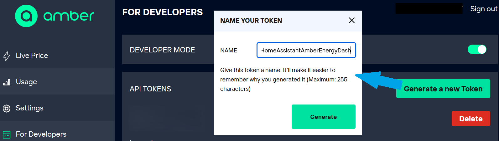

3. **Copy the token straight away** and store it in your password manager. Amber only shows
   it once; it disappears when you refresh the page. It starts with `psk_`.

   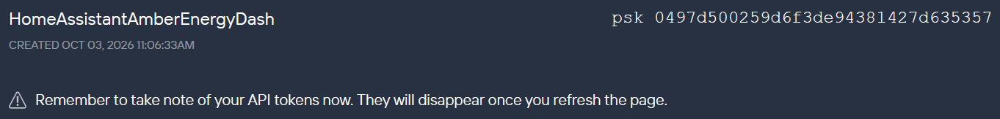

   *(The token in this screenshot was deleted straight after it was taken. Never share a
   working token.)*

The integration works alongside Home Assistant's built-in **Amber Electric** integration,
which provides live prices. You can keep both.

## 2. Install through HACS

1. In HACS, open the **three-dot menu** (top right) and choose **Custom repositories**.

   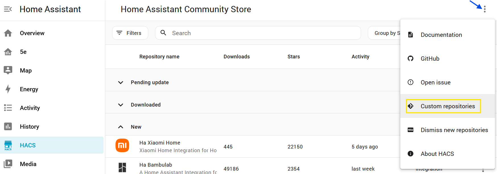

2. Enter `https://github.com/r5e/ha-amber-energy-dashboard`, choose the type
   **Integration**, and click **Add**. Then close the dialog.

   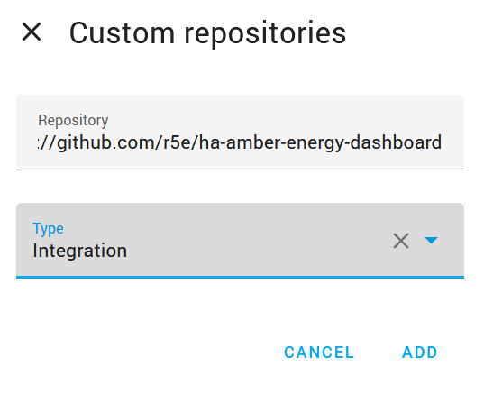

3. Search HACS for **amber**, and open **Amber Energy Dashboard (unofficial)**. (Other
   Amber-related entries in the list are separate projects.)

   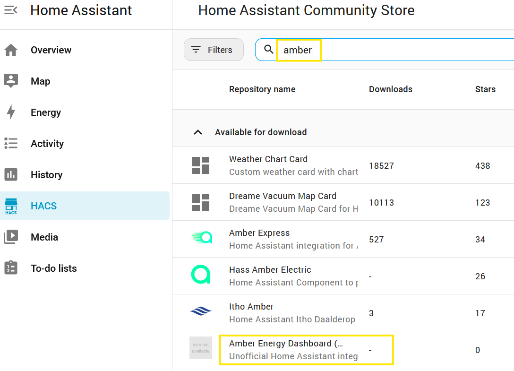

4. Click **Download** (bottom right).

   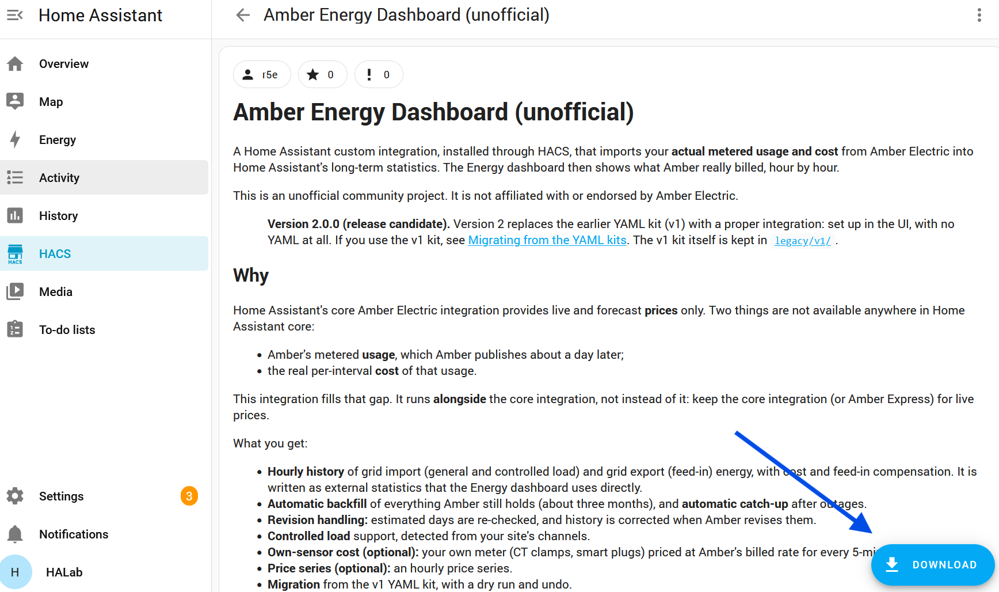

5. Click **Download**, then **restart Home Assistant** when prompted.

   HACS offers the latest release.¹

¹ *Pre-releases (betas and release candidates) are not offered by default. To try one,
open **Need a different version?** in the download dialog and pick it from the list.*

## 3. Add the integration

1. Go to **Settings > Devices & services > Add integration**, and search for **Amber**.
   Choose **Amber Energy Dashboard (unofficial)**, not the built-in Amber Electric
   integration.

   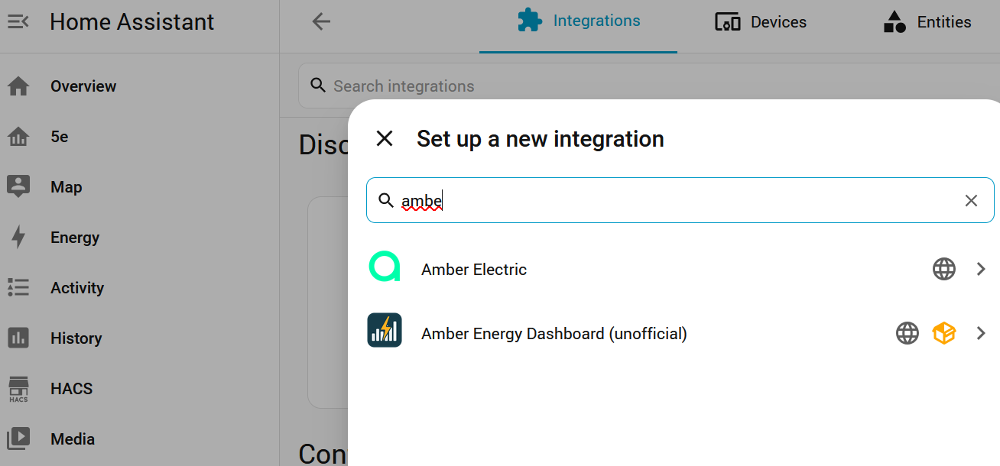

2. **Connect to Amber:** paste your API key and click **Submit**.

   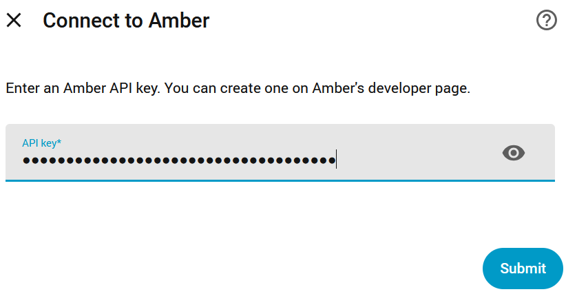

3. **Choose a site:** if your Amber account has more than one site, pick the first one to
   set up. The entry is your Amber account; you add its other sites afterwards with
   **Add site** (see "More than one site" in section 4). Each site is shown with the last
   four digits of its NMI and its network.

   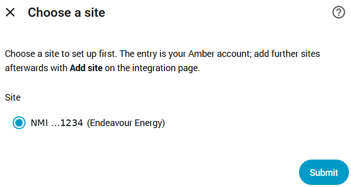

4. **Name the site:** the integration shows the site's details (its network, the last
   four digits of its NMI, and the date it became active with Amber) and asks for a
   friendly name, for example **Home** or **Beach house**. The name becomes the site
   device's name; entity IDs don't depend on it. If you also use Amber Express, giving
   the site the same name there makes the two sets of devices easy to match. To rename
   the site later, see "Renaming the site" in section 4.

   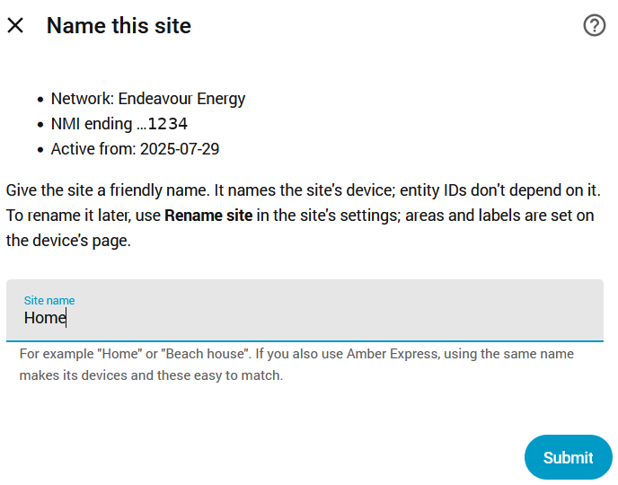

5. **Confirm channels:** the integration lists the metering channels it found, for
   example a general (import) channel and a feed-in (export) channel, each with its
   tariff code. Usage, cost and feed-in compensation are imported for each one.

   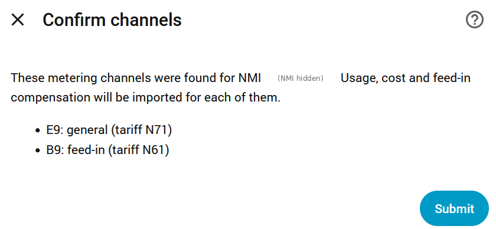

6. **Import schedule:** keep **Automatic** unless you have a reason not to. It picks a
   stable time for your installation each morning (between 06:30 and 08:30), with retries
   3 and 6 hours later. If Amber still hasn't published the day by then, it keeps trying
   every 3 hours until 22:00. Once the day is imported, the remaining attempts are skipped
   without any API calls. **Fixed times** lets you choose up to 6 times yourself.

   If the Energy dashboard has no grid connection yet, this step also offers **Add to the
   Energy dashboard** (on by default). It adds a grid connection with this site's
   consumption and cost and, with feed-in, its return to grid and compensation (a
   controlled load gets a second grid connection), so you can skip section 6. An existing
   grid connection is never changed, and the option isn't shown then.

   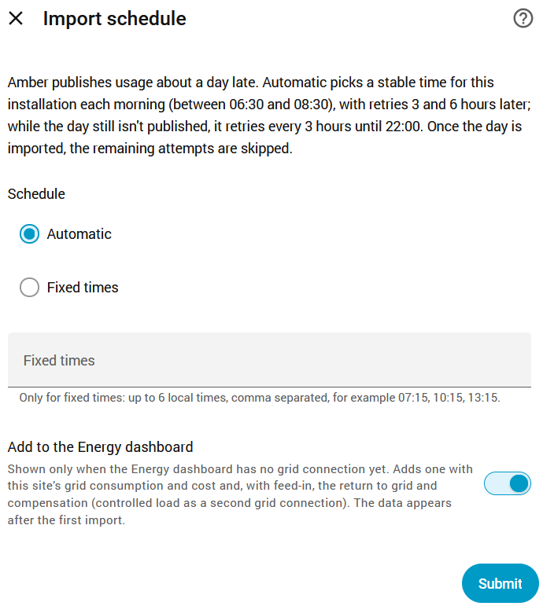

7. **Name and assign:** optionally assign the site's device to an area, then click
   **Finish**. The device already has the site's name.

   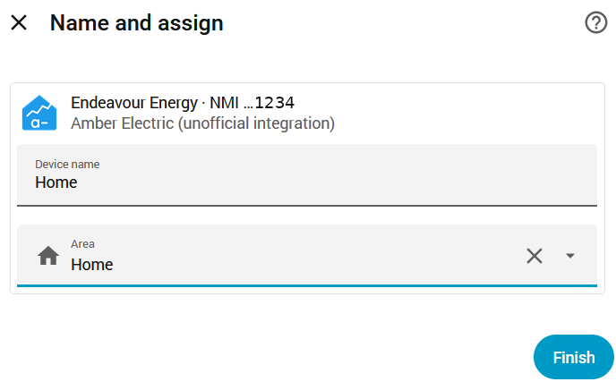

The integration then imports your available history straight away (Amber keeps about 90
days). That takes a minute or two and about 15 API calls.

## 4. After setup

Open the site's device (named after your site, for example **Home**) to see its status.
Its model line shows the network and the NMI's last four digits, for example
"Endeavour Energy · NMI …1234":

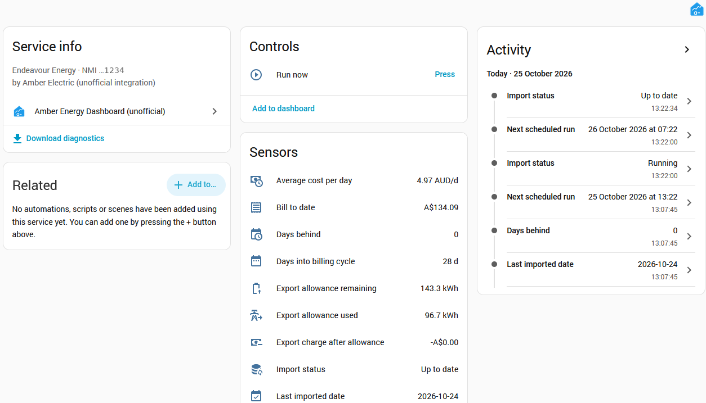

- **Import status** reads **Up to date** when everything is imported.
- **Last imported date** is normally yesterday, because Amber publishes each day's usage
  about a day later.
- **Days behind** is 0 when it's up to date.
- **Yesterday** sensors show the previous day's energy, cost and feed-in compensation per
  channel.
- **Next scheduled run** (under Diagnostic) shows when it will next check.
- **Run now** (under Controls) runs the import straight away, the same as a scheduled run.
  You rarely need it.
- **Re-check retention** (under Diagnostic) finds the oldest day Amber still holds again
  from scratch (at most 8 API calls). The daily check normally follows it by itself.
- With the **bill estimate** or the **export allowance** turned on (section 5), their
  sensors appear here too:

  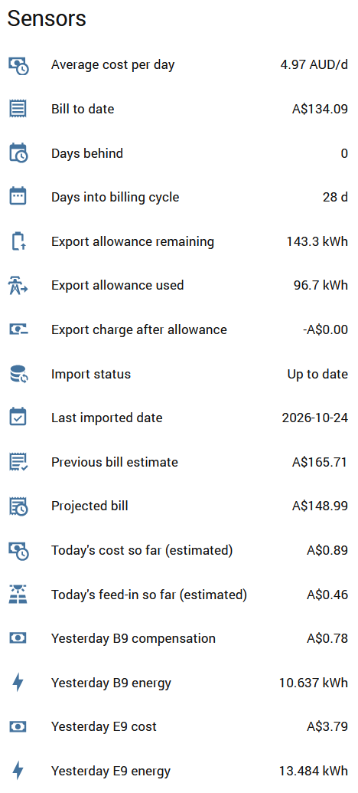

- With a **grid meter** and a **live price**, **Today's cost so far (estimated)** and
  **Today's feed-in so far (estimated)** appear here too ([Today so far](#today-so-far)).
- **Download diagnostics** produces a file for bug reports. Your API key, your NMI and
  the names you gave (the site, grid meters and appliances) are redacted from it.

### How the integration page is laid out

The integration's own page is **Settings > Devices & services > Amber Energy Dashboard**.
The entry is your **Amber account** (its API key), titled **Amber Energy Dashboard**. If
you set up a second account (a second API key), each title gets its first site's name,
for example **Amber Energy Dashboard (Beach house)**. Rename an entry (its **⋮** menu) and
the integration leaves your name alone.

Under the entry, Home Assistant groups the sub-entries by kind:

- **Site:** each site, titled by its name (for example **Home**). Its device, named after
  the site, holds the status sensors, the Yesterday sensors and the buttons described
  above. The pencil on the site's row opens its settings (section 5).
- **Grid meter** and **Appliance:** each one you add (section 5), listed by its title, for
  example **Whole house meter · grid meter** or **Pool heat pump · appliance (general
  E1)**. Each has its own device, named as you named it, which holds its sensors and links
  back to its site's device.

The buttons at the top add a **site**, a **grid meter** or an **appliance**. An install
upgraded from version 2.1 may also show **Own energy sensor (2.1)** rows until they are
converted (see [section 9](#9-upgrading-from-version-21)).

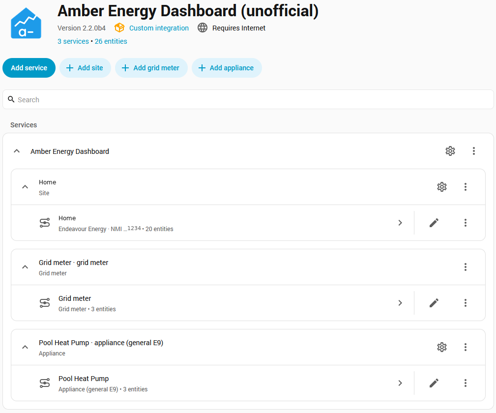

### More than one site

If your Amber account has several sites (for example a home and a holiday house), click
**Add site** on the integration's page. It lists the sites your API key can see that aren't
set up yet; choose one, give it a name, and confirm its channels. Each site imports on its
own schedule, but the sites of one account take turns, so together they stay within
Amber's rate limit (which belongs to the account).

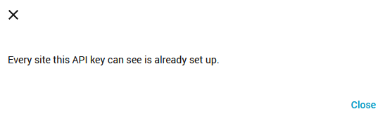

The site's entity IDs: the first site keeps `sensor.amber_energy_dashboard_…`; a further
site's follow its name, for example `sensor.beach_house_import_status`. Services and
actions take the site's device as **site** when there are several.

If the account's API key no longer sees one of the sites (for example a closed site, or
one moved to another account), that site is skipped and a Repairs item names it; the
other sites keep running. Delete a closed site from its **⋮** menu (its statistics are
kept). If the key sees none of the sites, Home Assistant asks you to re-authenticate.

### Renaming the site, areas and labels

To rename a site, open its settings (below) and choose **Rename site**. It renames both
the site's row on the integration page and its device. Entity IDs never change with the
name.

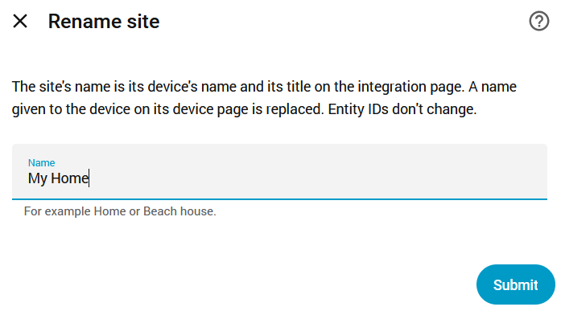

Areas and labels are set on Home Assistant's own device page (the site's device, then the
**pencil** icon). A name you give the device there is also used as the site's name (for
example, with several entries, in the entry's title, unless you renamed the entry
yourself); **Rename site** replaces it.

## 5. Settings

A site's settings open from the **cog** next to the entry (with several sites, it asks
which one first) or from the **pencil** on the site's row. Both show the same menu:

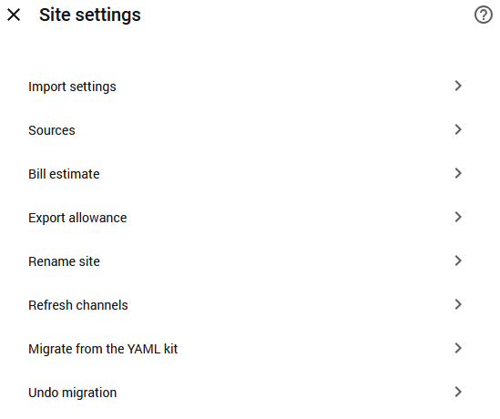

The menu has **Import settings**, **Sources**, **Bill estimate**, **Export allowance**,
**Rename site**, **Refresh channels** and **Migrate from the YAML kit** (and **Undo
migration** after a migration).

**Import settings** contains:

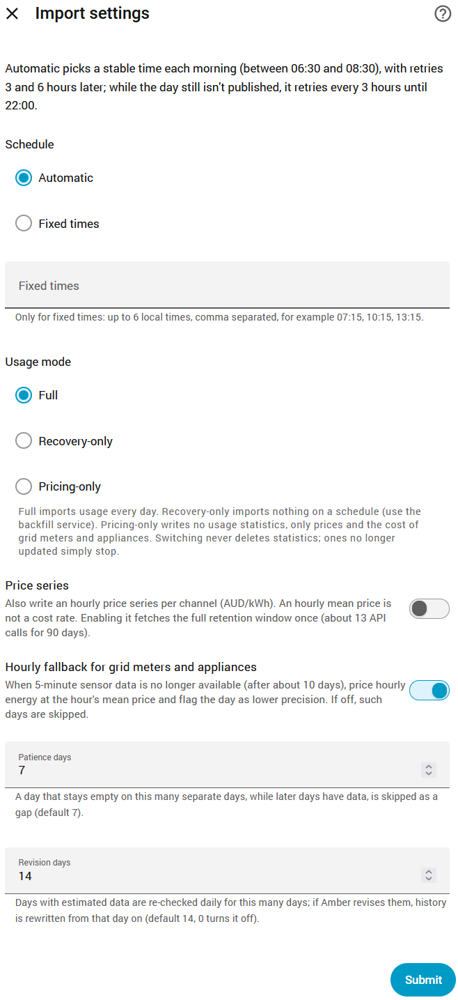

- **Schedule:** Automatic or Fixed times, as during setup.
- **Usage mode:**
  - **Full** (default): imports usage and cost every day.
  - **Recovery-only:** imports nothing on a schedule. Use the `backfill` service to fill a
    date range on demand.
  - **Pricing-only:** writes no usage statistics, only prices and the cost of grid meters
    and appliances.

  Switching mode never deletes statistics; ones no longer updated simply stop.
- **Price series:** optionally write an hourly price series per channel. Turning it on
  fetches the full retention window once (about 13 API calls).
- **Hourly fallback for grid meters and appliances** (below): Home
  Assistant keeps 5-minute data for only about 10 days. With this on (the default), older
  days are priced from hourly energy at the hour's average price and marked "lower
  precision"; with it off, they are skipped.
- **Patience days** and **Revision days:** how long to wait for missing days, and how long
  to re-check days Amber marked as estimated. The defaults suit almost everyone.

### Refresh channels

If Amber starts reporting a new metering channel for a site (for example a newly installed
controlled load), imports pause and a Repairs item says so. Open the site's settings and
choose **Refresh channels**: it shows what changed, and the new channel's statistics start
from the day imports paused.

### Bill estimate (optional)

Choose **Bill estimate** in the site's settings:

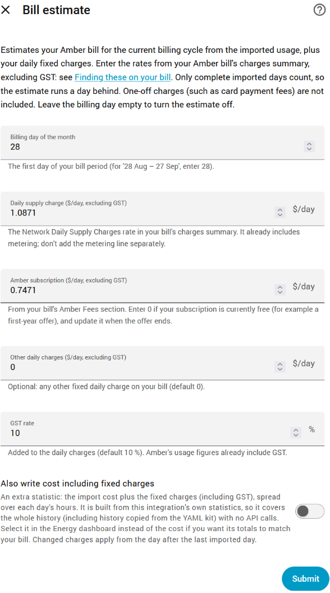

Enter your **billing day**, the **daily supply charge**, the **Amber subscription** per
day, any **other daily charges** (all excluding GST), and the **GST rate** (10 %). See
[Finding these on your bill](#finding-these-on-your-bill) below. The device then shows
**Bill to date**, **Projected bill**, **Days into billing cycle** and **Average cost per
day** for the current cycle, and **Previous bill estimate** for the cycle before it (its
total, with each line, its dates and `complete` once every day of it is imported: normally
the morning after it ends). The estimate runs a day behind, because only complete
imported days count, and it leaves out one-off charges such as card fees. Leave the
billing day empty to turn it off. An example [bill card](cards/README.md) shows both
cycles on a dashboard.

**Cost including fixed charges** (a checkbox in the same step) adds a statistic with your
import cost plus the fixed charges, for an Energy dashboard whose totals match the bill (see
section 6 for where to select it). It covers your whole history. If you change the charges
later, the new amounts apply from the day after the last imported day; earlier days keep
the old ones.

#### Finding these on your bill

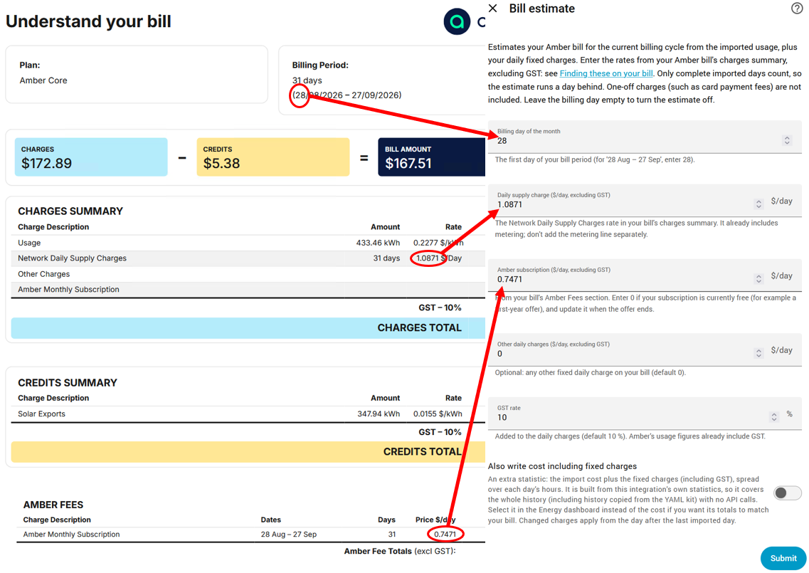

- **Billing day:** the first day of your bill period. For "28 Aug – 27 Sep", enter
  **28**.
- **Daily supply charge** ($ per day, excluding GST): the **Network Daily Supply Charges**
  rate in your bill's **charges summary** (for example 1.0871). It **already includes
  metering**, so don't add the metering line separately (see the picture above).
- **Amber subscription** ($ per day, excluding GST): from your bill's **Amber Fees**
  section (for example 0.7471). **Enter 0 if your subscription is currently free** (for
  example a first-year offer), and update it when the offer ends (see the picture
  above).
- **Other daily charges** ($ per day, excluding GST): any other fixed daily charge on your
  bill. Optional; 0 by default.
- **GST:** 10 % by default. The bill adds GST to these charges; the integration does the
  same. Amber's usage figures already include GST, and export credits carry none.
- **Not included:** one-off charges, such as card payment fees.

### Export allowance (optional)

Some networks charge for exports in a midday window beyond a free allowance applied on the
bill (Endeavour Energy's N61: 8 kWh a day, over the billing period). Amber's usage data
charges every kWh in that window, so feed-in earnings look lower than on your bill. For N61
with a billing day set, the integration turns this on by itself; otherwise choose **Export
allowance** in the site's settings and enter the allowance per day:

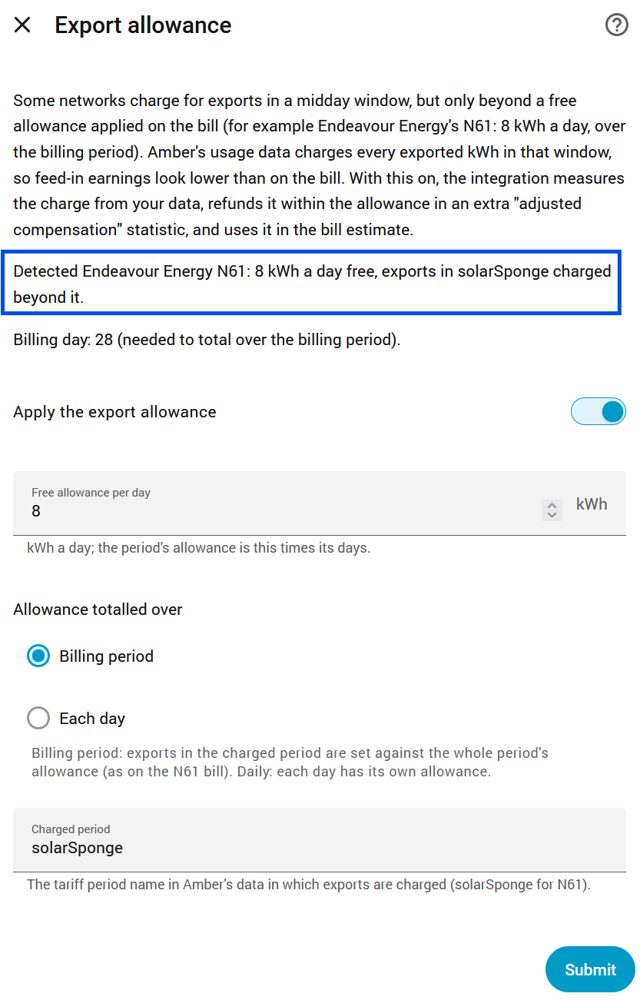

It adds the sensors **Export allowance used**, **Export allowance remaining** and **Export
charge after allowance**, uses the allowance in the bill estimate, and writes an
**adjusted compensation** statistic. To show the adjusted earnings in the Energy dashboard,
select it as the grid connection's compensation (section 6). Turning the allowance on (or
changing it) measures your imported days straight away, in the background, with a few API
calls; you don't need to press **Run now**.

### Adding a grid meter

A **grid meter** measures the energy flowing through your main supply, the same energy
Amber bills. Examples:

- a CT clamp or energy monitor on the mains feed;
- the grid meter of an inverter or battery system, for example a Sigenergy system's grid
  sensor or a Fronius smart meter.

On the integration's page, click **Add grid meter** and fill in the form below (if your
account has several sites, it first asks which site the meter belongs to):

- **Name:** for example **Whole house meter**. It names the meter's device and sensors.
- **Import energy sensor:** cumulative energy drawn from the grid (a kWh sensor that
  keeps rising, state class `total` or `total_increasing`).
- **Price import on:** shown only if your site has a controlled load: choose controlled
  load for a meter on that circuit. Otherwise the general channel is used.
- **Export energy sensor** (optional, shown when your site has a feed-in channel): the
  energy sent to the grid, priced at the feed-in rate.

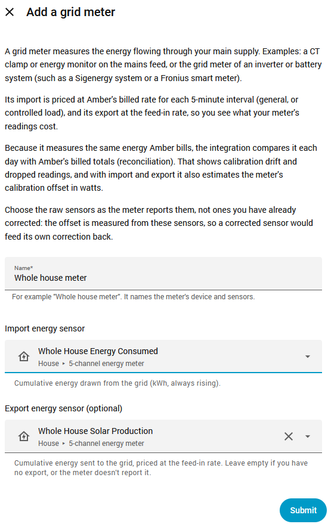

The integration then prices the meter's readings at Amber's billed rate for each 5-minute
interval, from the later of the sensor's history start and Amber's retention boundary:
`amber_energy_dashboard:<site>_own_<sensor>_cost` for the import and
`…_own_<sensor>_cost` (positive when earned) for the export.

The meter's device has:

- **Import reconciliation** and **Export reconciliation:** for the latest day both have,
  your meter's kWh minus Amber's billed kWh (the percentage and both totals are
  attributes). Because the meter measures the energy Amber bills, a difference shows
  calibration drift or readings that went missing.
- **Calibration offset** (with import and export): for each hour of the last 14 complete
  billed days, Amber's net energy (import minus export) minus the meter's, in watts. The
  sensor shows the **mean**, because that is the correction that makes the meter's energy
  totals match the bill (a few hours of rapid switching between import and export can
  disagree strongly, and only the mean accounts for them). The median (`median_w`), the
  spread (`iqr_w`, the interquartile range), the hours used and the date range are
  attributes. Only hours where the meter's statistics have a gap are left out.
  A CT clamp typically shows a small, steady offset (tens of watts); an inverter's
  revenue-grade meter shows close to 0 W.

**Map the raw sensors.** Choose the sensors as the meter reports them, not ones you have
already corrected (for example with a template that adds the offset). The offset is
measured from the mapped sensors, so a corrected sensor would feed its own correction back
and the offset would drift towards zero.

### Adding your own appliances

An **appliance** is any single energy sensor. Examples:

- a smart plug;
- a CT clamp on one circuit;
- an appliance's own energy sensor, such as a heat pump or a hot water system;
- an EV charger.

Click **Add appliance** (with several sites, choose the site first) and fill in a **Name** (for example **Pool heat pump**), the
**Energy sensor**, and, if your site has a controlled load, the channel to price it on
(general by default; controlled load for, say, a hot water system on that circuit).
Tick **Solar-aware cost** for a second cost that values the part covered by your solar
at the feed-in price ([below](#solar-aware-cost)); on an existing appliance, use its
**Reconfigure** (the pencil on the appliance's row).

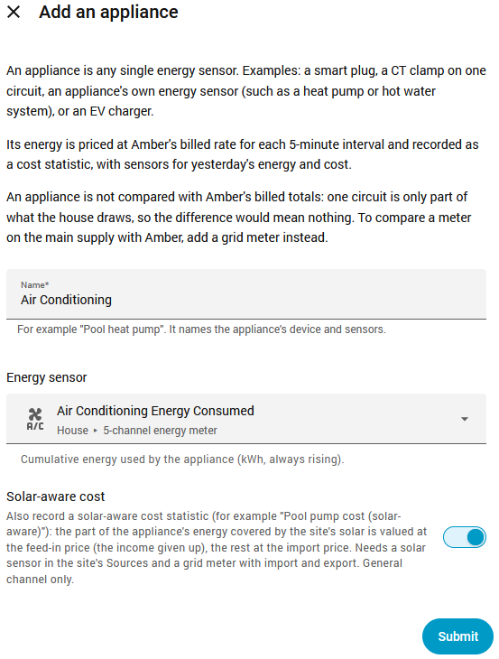

The appliance's cost is recorded as a statistic in the same way, and its device shows
**Yesterday energy** and **Yesterday cost**. An appliance is not compared with Amber's
billed totals: one circuit is only part of what the house draws, so the difference would
mean nothing.

A sensor can be priced by one grid meter or appliance only.

### Solar-aware cost

An appliance's normal cost prices all its energy at the import price Amber billed. When
the sun is shining, part of that energy came from your own solar: it cost nothing to
import, but you gave up the feed-in price you would have earned by exporting it. With
**Solar-aware cost** on, the appliance also gets:

- a statistic **"<name> cost (solar-aware)"**
  (`amber_energy_dashboard:<site>_own_<sensor>_cost_solar_aware`), which you can add to an
  energy or statistics graph next to the normal cost;
- a **Yesterday solar-aware cost** sensor, with yesterday's split as attributes:
  `solar_kwh`, `battery_kwh`, `grid_kwh`, `solar_share`, and `allowance_adjusted` (with
  the export allowance: whether that day's feed-in value includes the refund).

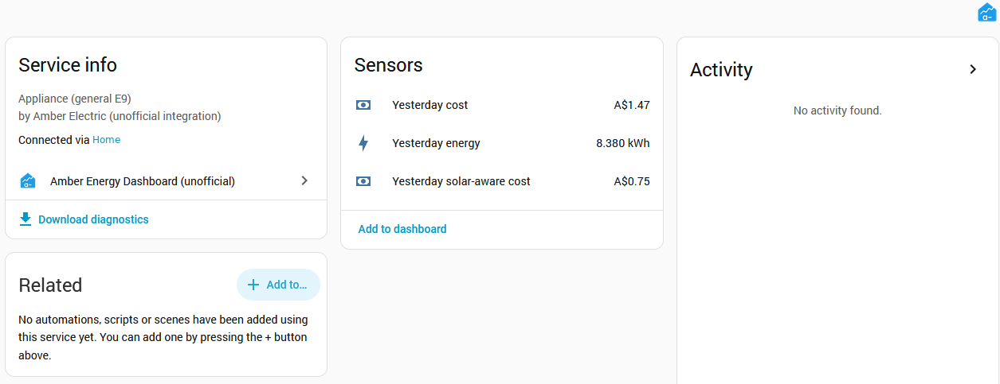

**It needs:**
- a **solar sensor** in the site's [Sources](#sources): the solar energy produced (best),
  or the solar power (its statistics are used);
- a **grid meter with import and export** (the one Today so far uses, if it has an
  export);
- an appliance on the **general** channel (a controlled load is metered separately).

**How it is worked out.** For each 5-minute interval, from the site's net flows (grid
import, grid export and solar, plus the battery's charge and discharge if you set those
sensors):

- the house's load = import + solar + battery discharge − export − battery charge;
- the load is covered by solar first, then the battery, then the grid;
- the appliance's energy is split in the same proportions as the house's load;
- the solar part is valued at the interval's **feed-in price** (from Amber's billed
  data), the grid part at the **import price**, as for the normal cost.

With the [export allowance](#export-allowance-optional) on, the feed-in price in the
penalty window (for example 10:00 to 14:00) includes the network's export charge refunded
while the period's exports are within the allowance: what an extra exported kilowatt-hour
would really have earned.

**Limits:**
- Flows inside each 5-minute interval are netted. The share is the house's average for
  the interval, not the appliance's own: two appliances running at the same time get the
  same solar share.
- Your sensors must agree with each other: an inverter's solar reading and a CT clamp's
  grid readings that disagree give a wrong load. The calibration offset is not applied.
- **Battery:** with battery sensors, battery discharge is shown as its own share
  (`battery_kwh`) but is, for now, valued at the import price. Valuing it at the average
  cost of the energy that charged the battery (solar at the feed-in price, grid at the
  import price) is planned for version 2.3.
- Home Assistant keeps 5-minute statistics for about 10 days. Older days (and days when
  one of the sensors has only hourly statistics) use hourly shares and the hour's average
  prices, and are marked "lower precision", as for the normal cost.
- **Solar sensors that go offline at night** (most inverters stop reporting after sunset)
  are handled: hours with no statistics count as no production when the solar energy
  total is the same before and after the gap, or when the gap is at night (from an hour
  before sunset to an hour after sunrise, at your Home Assistant's home location; it may
  end up to three hours after sunrise, for an inverter that wakes late). A solar power
  sensor's gap also counts as no production when it reads 0 W on both sides. A gap that
  starts in daylight while the total changes (the inverter's connection dropped while it
  was producing) can't be placed, and that day is skipped as before. Grid meters and
  appliances still need complete statistics.
- If the solar sensor or the grid meter is removed later, the solar-aware cost waits;
  after more than 2 days a Repairs item names what is missing, so you can fix it before
  the days fall out of Amber's retention.
- Turning it on starts the statistic from the earliest day all the sensors have
  statistics for (at most Amber's usage retention). A day when one of the site's sensors
  has no statistics is skipped.
- When the feed-in price is negative (you pay to export), the solar part has a negative
  cost: using that energy saved you the charge.

### Sources

**Sources** in a site's settings lists the sensors the site's live estimates can use.
Billed figures always come from Amber's usage data; nothing here changes them.

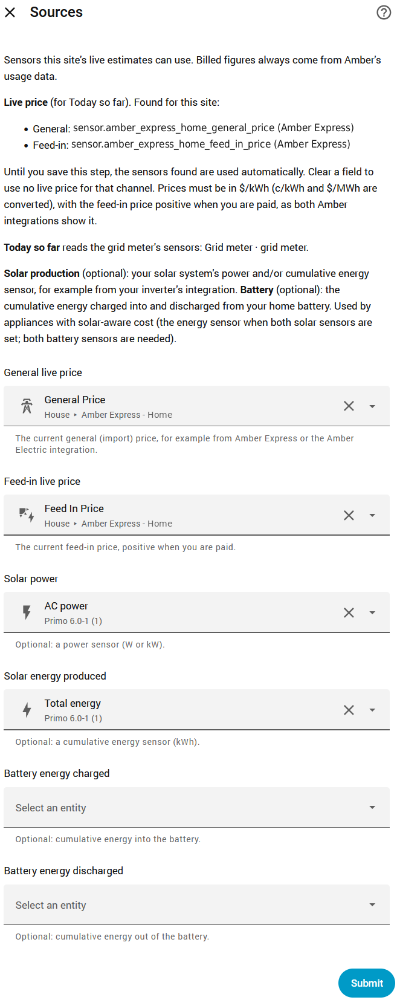

- **General live price** and **Feed-in live price:** the current price, used by **Today
  so far** (below). The integration looks for them itself: first
  [Amber Express](https://github.com/hass-energy/amber-express), then Home Assistant's
  built-in **Amber Electric** integration, set up for the same site. The step shows what
  it found. Until you save this step the sensors found are used automatically; clear a
  field to use no live price for that channel, or choose another sensor. Prices must be
  in $/kWh (c/kWh and $/MWh are converted), with the feed-in price positive when you are
  paid, as both Amber integrations show it. A price integration installed later, or
  whose sensors are registered after this integration starts, is picked up by itself
  (checked when Home Assistant has started, whenever its sensors are registered, and
  every minute for the first 15 minutes); Today so far then starts without a reload.
- **Grid meter for Today so far:** shown when the site has more than one grid meter on the
  general channel. The first one is used otherwise.
- **Solar power** and **Solar energy produced** (optional): your solar system's power
  sensor and/or its cumulative energy sensor, for example from your inverter's
  integration. Used by [solar-aware cost](#solar-aware-cost) (the energy sensor when
  both are set).
- **Battery energy charged** and **Battery energy discharged** (optional): cumulative
  energy into and out of your home battery. Used by solar-aware cost (both are needed).

### Today so far

When a site has a **grid meter** (with its import on the general channel) and a **general
live price**, its device gets:

- **Today's cost so far (estimated):** the meter's import since midnight, priced at the
  live price.
- **Today's feed-in so far (estimated)** (when the meter has an export sensor and the
  site has a feed-in live price): the meter's export, priced at the live feed-in price.

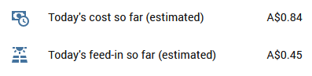

They are estimates, for display only, and are never written into long-term statistics.
Every 5 minutes the energy since the last 5-minute mark is priced at the price shown at
the end of that interval. "Today" is the NEM day Amber bills (midnight to midnight AEST;
during daylight saving, 01:00 to 01:00 local time).

- **Which sensors:** the grid meter's mapped sensors. Map the raw meter sensors (as the
  calibration offset needs).
- **Calibration offset:** the estimate applies the grid meter's calibration offset
  (`offset_w`), as the bill sees the meter's error: every 5 minutes the offset times the
  interval is added to the import while the interval imports, or taken from the export
  while it exports. Until the meter has an offset (a new grid meter needs a day of billed
  data), the energy counts as measured. `offset_corrected_intervals` shows how many of
  today's intervals had the offset. In the maintainer's first full-day comparison the
  corrected estimate was 1.0 % under the bill, against 1.8 % without the offset.
- **Attributes:** the energy (`energy_kwh`), the estimate without the offset
  (`raw_estimate`, with `raw_energy_kwh`), the intervals priced so far against those
  elapsed, any energy without a usable price (`unpriced_kwh`), the sensors used, and
  **`yesterday_estimate_vs_billed`**: once Amber's data for a day arrives (normally the
  next morning), the day's estimate against the billed amount and kWh, with the error
  (estimate minus billed) for both estimates: `estimated_corrected`, `error_corrected`
  and `error_corrected_percent` for the sensor's value, and `estimated_raw`, `error_raw`
  and `error_raw_percent` without the offset. `complete` is true when every interval of
  that day was priced.
- **Bill to date** (with the bill estimate on) gets **`including_today_estimated`**: the
  bill to date plus today's cost, minus today's feed-in, plus a day of fixed charges
  (`including_today_estimated_raw` is the same without the offset). It is shown once
  yesterday has been imported. `including_today_leaves_out` lists what the estimate can't
  see (for example the controlled load).
- After a restart, energy used while Home Assistant was down is priced at the first price
  seen afterwards (or dropped if the downtime spans midnight). A meter reset drops that
  interval.

## 6. Add it to the Energy dashboard

If you kept **Add to the Energy dashboard** on during setup (section 3), this is already
done. A day after the first import, if nothing in the Energy dashboard uses the
integration's statistics, a Repairs item **"The Energy dashboard isn't using Amber Energy
Dashboard"** appears. Its **Fix** adds them when there is no grid connection, points to
the [migration guide](MIGRATION.md) when the YAML kit is in use, or lets you dismiss it.

To set it up by hand, go to **Settings > Dashboards > Energy**, and in the **Electricity
grid** section, add or edit a grid connection. For cost and compensation, always choose
**Use an entity tracking the total costs** (or **the total received**), never "current
price". Choose the statistics like this (`<ch>` is the channel, for example `e1`):

| Field | Statistic | When |
|---|---|---|
| Grid consumption | general `…_<ch>_energy` | Always |
| Cost | general `…_<ch>_cost` | The default: your usage at Amber's billed prices |
| Cost | `…_<ch>_cost_incl_fixed` ("import cost including fixed charges") | If you turned it on under **Bill estimate** and want the dashboard's cost to match your bill. It already includes a controlled load's cost, so then leave the controlled-load connection's cost empty |
| Return to grid | feed-in `…_<ch>_energy` | Always, if you export |
| Compensation | feed-in `…_<ch>_compensation` | The default: your feed-in earnings as Amber's data pays them |
| Compensation | `…_<ch>_compensation_adjusted` ("compensation (export allowance applied)") | With the **Export allowance** on (two-way tariffs such as N61): matches the export credit on your bill |
| Controlled load | a second grid connection: controlled-load `…_<ch>_energy`, cost `…_<ch>_cost` | If you have a controlled load (leave its cost empty with the cost including fixed charges, as above) |

The optional statistics cover your whole history, so switching to them also changes how
past days are shown. "Add to the Energy dashboard" and the Repairs fix use the default
statistics; switch to the optional ones by hand. Give the connection a clear display name,
such as "Amber grid".

## 7. Migrating from the YAML kit

Only needed if you used the earlier YAML kit. See the separate
**[migration guide](MIGRATION.md)**: it carries your history across and fixes the kit's
feed-in sign, with a dry run and undo.

## 8. Troubleshooting and FAQ

**My feed-in earnings are lower than the export credit on my Amber bill.**
Amber's usage data applies your network's export charges to every interval. Some networks
offer a free export allowance (for example Endeavour Energy's two-way tariff N61, which has
8 kWh per day free before a midday export charge applies), and your bill applies that
allowance, but the usage data doesn't. So the dashboard can show lower feed-in earnings
than the bill. The **Export allowance** option (section 5) corrects for it. Import costs match the bill to the cent (they include GST; the bill adds GST
at the end).

**My dashboard total doesn't include supply and subscription charges.**
Amber's usage data covers usage only. The daily supply charge (network and metering) and
Amber's subscription are separate charges on your bill. The **Bill estimate** option
(section 5) adds them.

**Today so far is missing.**
It needs a grid meter whose import is on the general channel, and a general live price.
Open the site's settings, **Sources**: it shows the live price it found (Amber Express or
Amber Electric for the same site) and the grid meter it uses. A price integration set up
later is picked up within a few minutes.

**Something else.**
Download diagnostics from the integration's device page, and open an issue on GitHub with
the file attached. Your API key, your NMI and the names you gave are redacted
automatically; your usage figures are not, so check the file first.

## 9. Upgrading from version 2.1

This section is for an install of version 2.1 (or 2.0) that you update to 2.2. Updating
from a 2.2 beta needs none of it.

> [!WARNING]
> **Take a Home Assistant backup before you update** (Settings > System > Backups). At its
> first start, version 2.2 moves the integration to a new layout that 2.1 can't read.
> **There is no downgrade:** to go back to 2.1, restore the backup. Installing 2.1 over 2.2
> leaves the integration unable to load ("Migration error").

### Updating

1. Take the backup.
2. In HACS, open **Amber Energy Dashboard (unofficial)** and click **Update** (or
   **Redownload** and pick the version).
3. Restart Home Assistant.

At the first start the integration moves itself to the new layout. Your statistics and
their history, every entity ID, your settings, the Energy dashboard and any YAML-kit
migration (including its undo) are kept. If Home Assistant stops in the middle of it, the
next start finishes it.

### What changes on the integration page

- **The entry is now your Amber account** (its API key), and your site is a **Site** row
  under it, which owns the site's device and its sensors and buttons. Entries titled
  "Amber <NMI>" become **Amber Energy Dashboard**.
- **The site's row is titled "Site …1234"** (the NMI's last four digits) and its device
  keeps the name **Amber Energy Dashboard (site)** until you give the site a name: open its
  settings and choose **Rename site** (section 4). Entity IDs don't change.
- **Settings belong to the site:** the cog next to the entry (it asks which site when there
  are several) and the pencil on the site's row open the same menu (section 5). New items:
  **Sources** and **Rename site**. **Refresh channels** replaces the entry's Reconfigure.
- **Add own energy sensor** is replaced by **Add grid meter** and **Add appliance**, and
  **Add site** sets up another site of the same account.
- The heading **"Devices that don't belong to a sub-entry"** is gone: every device belongs
  to a site, a grid meter or an appliance.
- **Repairs items you ignored in 2.1 come back** if they still apply (they are now kept
  per site); ignore them again if you wish.
- Services and actions take an optional **site**; `config_entry_id` still works with one
  site.

### Converting your own energy sensors

Own energy sensors added in 2.1 **keep working unchanged** after the update: the same
statistics, entity IDs and reconciliation sensors. They are listed as **Own energy sensor
(2.1)**. A Repairs item, **"Convert own energy sensors to grid meters and appliances"**
(Settings > System > Repairs), converts them when you are ready:

1. Open the Repairs item. It lists your own energy sensors and proposes a **grid meter**:
   your import (general or controlled load) sensor as its import, and your feed-in sensor
   as its export. Change the choice if needed (or choose **None** if none of them is on the
   main supply), and give the grid meter a name, for example **Whole house meter**.
2. Every other own energy sensor becomes an **appliance**, keeping its name.
3. Check the plan on the next screen, and submit. The integration reloads.

The cost statistics and their history are kept, and the grid meter's **Import
reconciliation** and **Export reconciliation** keep the old reconciliation sensors' entity
IDs, so your dashboards keep working. The grid meter also gets a **Calibration offset**
(when it has both sides). Appliances get **Yesterday energy** and **Yesterday cost** in
place of reconciliation. You can also ignore the Repairs item and keep the old sensors;
they just don't get the new features (solar-aware cost, Today so far).

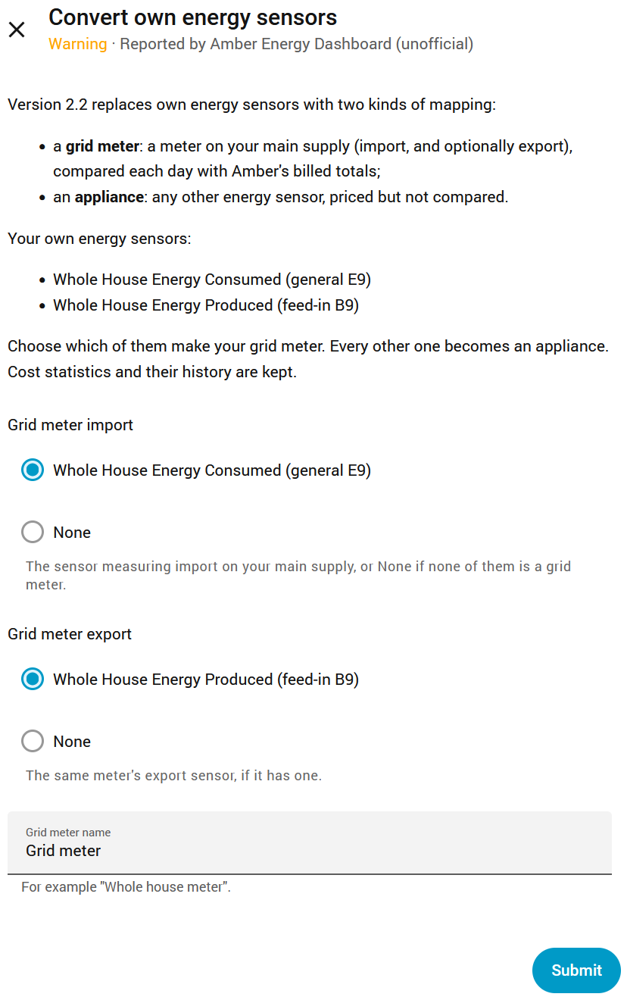

### New things to set up

- **Name your site** with **Rename site** (above).
- **Today so far:** with a grid meter and Amber Express or Amber Electric set up for the
  same site, the site's device gets **Today's cost so far (estimated)** and **Today's
  feed-in so far (estimated)** by itself. Check **Sources** in the site's settings to see
  what was found ([Sources](#sources), [Today so far](#today-so-far)).
- **Previous bill estimate** appears by itself when the bill estimate is on; an example
  [bill card](cards/README.md) shows it with the current cycle.
- **Solar-aware cost:** add your solar sensor in **Sources**, then turn it on for an
  appliance with its **Reconfigure** ([Solar-aware cost](#solar-aware-cost)).
- **Evening retries** need nothing: when Amber publishes a day late, the integration
  retries every 3 hours until 22:00.
